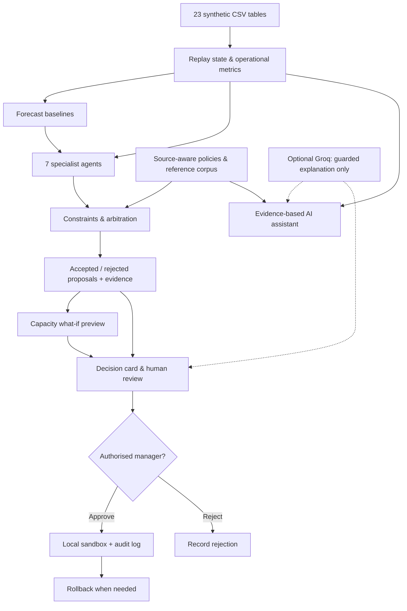
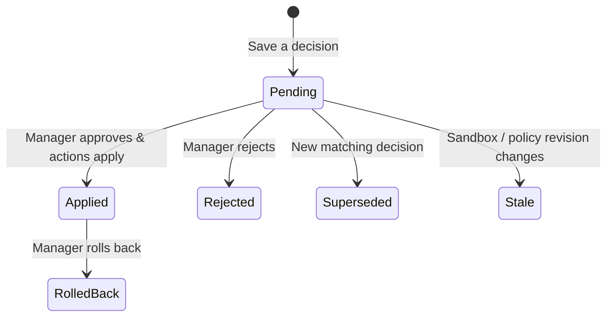

<div align="center">

<br />

<!-- Working README for the Zawolf hospital operations prototype. Not a final product specification. -->

# 🏥 Hospital Digital Twin

### An Agentic Hospital Operations & Decision-Support Prototype

[](#-the-idea)

<br />


<br />


<br />

**One place to explore hospital operations, identify bottlenecks, review agent proposals, and test decisions safely — before anyone approves a change.**

*An Arabic-first operational dashboard built for experimentation, transparent reasoning, and iterative team development.*

**[Explore the System](#-what-you-can-explore)** · **[Architecture](#-how-the-system-works)** · **[Run Locally](#-quick-start)** · **[Testing Guide](#-testing--team-handoff)** · **[Roadmap](#-roadmap)**

</div>

---

> [!IMPORTANT]
> **Work in progress · Synthetic data · Not a clinical system.** This repository is a development and testing prototype, **not a validated hospital deployment**. All patient and operational records in the bundled dataset are fictional. The system does not connect to live hospital equipment, patient records, or production scheduling systems. Agent suggestions are *proposals*, not clinical instructions or automatically executed decisions.

## ✦ The Idea

A hospital has many moving parts: beds, emergency arrivals, ICU demand, staff shifts, operating rooms, appointments, and resources. Looking at them one dashboard at a time can hide the dependencies between them.

**Hospital Digital Twin** explores a different workflow:

1. **Observe** the hospital's operating state at a selected moment using a consistent synthetic dataset.
2. **Understand** occupancy, waiting, workload, operating-room utilisation, forecasts, and data-quality warnings.
3. **Propose** possible operational changes through **seven specialised agents**.
4. **Verify** proposals against available capacity, scheduling constraints, sourced policies, and safety checks.
5. **Preview** the impact that the current engine can actually calculate, and explicitly mark the impact it *cannot* verify.
6. **Approve, reject, or roll back** sandbox changes through an auditable, role-controlled workflow.

The goal is to move from **“Here are the hospital's metrics”** to **“Here is the issue, here is the evidence, here are the possible actions, and here is what we can and cannot prove.”**

### At a glance

| | Current implementation |
|:--|:--|
| **Purpose** | Operational visibility, constrained proposals, and sandbox-based decision support |
| **Interface** | Responsive dark dashboard; Arabic RTL by default, English optional |
| **Backend** | Python 3.11+ standard-library HTTP server and JSON endpoints |
| **Source of truth** | Bundled synthetic CSV data and source-aware operational policies |
| **Agent engine** | Seven deterministic, domain-specific agents + arbitration/constraint checks |
| **Forecasting** | Historical baseline methods with error reporting; **not** calibrated clinical predictions |
| **Digital twin** | Historical replay and capacity **what-if preview**, **not** a 3D model or queue simulator |
| **AI assistant** | Evidence-backed local answers; optional Groq rewording |
| **Decision control** | Authenticated, human-approved, auditable changes inside a local sandbox only |

---

## ✦ What You Can Explore

The current dashboard contains **13 functional sections** organised around hospital operations.

| Section | What it answers |
|:--|:--|
| 🧭 **Overview** | What is happening in the hospital at the selected replay moment? |
| 🚨 **Alerts & Recommendations** | Which conditions need attention, and what evidence supports them? |
| 🛏️ **Beds & ICU** | How many beds are available, occupied, or potentially insufficient? |
| 🚑 **Emergency & Departments** | How are ER arrivals, waiting times, and department loads changing? |
| 👩‍⚕️ **Staff & Nursing** | What do the recorded shifts, availability, and workload show? |
| 🩺 **Operating Rooms** | How are ORs utilised, and what is booked or delayed? |
| 📈 **Forecasting** | What do the baseline forecasts predict, and how inaccurate have they been? |
| 🧩 **AI Agents** | Which agents proposed changes, abstained, or had proposals rejected? |
| 🧪 **Digital Twin** | What happens to **calculated capacity** under a chosen stress scenario? |
| ✅ **Decisions** | Which decisions are pending, applied, rejected, or rolled back? |
| 💬 **AI Assistant** | Can I ask an operational question in Arabic or English and inspect its evidence? |
| 📚 **Sources & Policies** | Which passages and structured policy values are being used? |
| 🛠️ **Data & System** | What is working, what data is unreliable, and is Groq configured? |

<details>
<summary><b>🎨 Dashboard design notes</b></summary>

- **Dark, card-based UI**, with KPI sparklines, charts, interactive panels, and responsive layouts.
- **Arabic-first RTL** interface with an English switch.
- Consistent meaning for visual accents: **cyan** = observed, **violet** = forecast, **amber** = preview/simulation, **green** = agent outputs, **red/amber** = warnings.
- Operational figures are sourced from backend responses rather than placeholder KPI values.
- The hospital diagram is a **data-driven department/bed schematic**, **not** a real building plan or 3D representation.

<!-- Once the team captures clean browser screenshots, add them here, for example:
<table><tr><td></td><td></td></tr></table>
Do not use synthetic visual mockups labelled as application screenshots. -->

</details>

---

## ✦ How the System Works



**Read this diagram carefully:** the agent engine and the conversational assistant are **not the same component**. The agents produce operational proposals. The assistant answers questions using information already gathered by the backend; it does **not** independently approve changes or run an unrestricted autonomous agent workflow.

### A. The seven specialist agents

| Agent | Responsibility | Typical output / current constraint |
|:--|:--|:--|
| 🚑 **ER Agent** | Emergency capacity pressure | Abstains when the required ER demand forecast or staffing evidence is unavailable |
| 🛏️ **Bed Agent** | Bed-capacity rebalancing | Proposes reallocations; nurse-ratio and pool checks can block them |
| 👩‍⚕️ **Staff Agent** | Staffing gaps and capacity | Needs suitable staff-demand inputs; can abstain rather than fabricate a need |
| 🩺 **OR Agent** | Non-urgent surgical rescheduling | May propose a later slot; future-slot coverage and real availability still need careful validation |
| 📅 **Appointment Agent** | Clinic overbooking | Moves eligible non-urgent bookings when an appropriate later slot exists |
| 📦 **Resource Agent** | Resource-pool rebalancing | Only operates on explicitly configured resource types; otherwise abstains |
| 💰 **Finance Agent** | Financial warning signals | Advisory-only; needs an explicit risk threshold and an available baseline |

All proposals pass through **arbitration**. A technically possible suggestion is not automatically safe or approved. The engine can reject it when supporting nurse policies, resource pools, time slots, or other required evidence is missing.

### B. What “Digital Twin” means *in this version*

The prototype reconstructs a selected **historical state** and estimates a scenario's **peak demand relative to capacity**. It shows:

- Baseline beds, projected peak demand, and calculated shortfall.
- Capacity before/after **accepted actions**.
- Actions the engine accepted or rejected and the reasons.
- Rate-based bed-capacity cost changes, where computable.
- A clear **Unavailable** state for effects without a connected evaluator.

**It does not yet simulate** individual patient journeys, clinical outcomes, queue waiting time after each action, realised revenue changes, or overtime effects. Previously stored queue results in the data pack are **reference data**, not verified outputs of a currently connected scenario engine.

### C. What the AI assistant does

The assistant follows a deliberately constrained path:

```text
Question (Arabic / English)
       ↓
Intent + context routing
       ↓
Backend evidence: metrics / forecasts / agents / decisions / policies
       ↓
Local evidence-backed answer (works with NO API key)
       ↓ optional
Groq rewording → grounding checks → accept or fall back
```

The assistant can discuss beds, ICU, ER, staff, operations, forecasts, alerts, policy sources, decisions, and data quality. Recent turns help interpret follow-up questions. **Groq is optional**: the provider can help *phrase* a grounded answer, but it is not trusted to invent numbers, execute changes, or independently decide hospital policy.

**Not yet supported:** unrestricted natural-language what-if orchestration, broad document-answer synthesis, clinical advice, or a general-purpose autonomous hospital manager.

---

## ✦ Example: ICU Stress Scenario

> **Illustrative walkthrough from the synthetic demo**, not a hospital recommendation. Results vary with replay date, configured policies, and sandbox state.

Select the replay moment **17 October 2026, 08:00**, then open **Digital Twin → ICU → ×12 → Run Preview**.

| Metric | Example result |
|:--|--:|
| ICU beds available in baseline | 12 |
| Forecast peak demand under stress | ~43.6 |
| Computed shortfall | 32 beds |
| Reported utilisation at peak | ~363.6% |

In the tested state, the agents proposed **two non-urgent OR reschedules** while a **15-bed transfer** from the ward to ICU was rejected because the relevant staffing policy or verifiable nurse-pool constraints were missing. The preview still reported a **32-bed shortfall** because those accepted reschedules did not produce a verified capacity change in that calculation.

**Why this matters:** surfacing a severe bottleneck is useful, but **detecting pressure ≠ resolving pressure**. The UI must not claim that scheduling actions solved ICU demand when the measured shortfall did not improve. Proposed OR dates also require schedule-coverage checks before an operational decision can be considered reliable.

---

## ✦ Data: What Is Actually in the Repository?

The included data pack contains **23 CSV tables** covering **90 synthetic days** (**23 July to 20 October 2026**), plus a reference corpus used for source-aware retrieval.

<details>
<summary><b>📂 Show all 23 tables</b></summary>

| Area | Tables |
|:--|:--|
| Facilities & beds | `departments`, `rooms`, `beds`, `bed_stays` |
| Patients & care flow | `patients`, `visits`, `er_events`, `appointments` |
| People & staffing | `staff`, `staff_shifts`, `staff_assignments` |
| Surgery & resources | `operating_rooms`, `surgeries`, `resources`, `resource_bookings` |
| Finance & reporting | `cost_rates`, `financial_daily`, `daily_metrics` |
| Analytical / reference records | `forecast_results`, `simulation_runs`, `simulation_events`, `decisions`, `policy_documents` |

**Other assets:** `schema.sql` describes the data model and `data/combined.json` contains the supporting reference corpus.

</details>

### Known data limitations

- **Synthetic, not real-world:** no clinical or production validation is implied.
- **Some staff-shift days are unreliable**, with unusually low or high counts; missing records cannot prove safe staffing.
- **ICU occupancy is low and irregular**, so weekday-based forecasts can have very high percentage error. Backtests must be read with this context.
- **Historical coverage is finite.** Planned bookings beyond the supplied scheduling horizon should not be assumed to have a verified free slot just because no later record exists.
- **Reference policies are not automatically approved operational rules.** A manager-entered ratio is explicitly labelled as an entered, non-approved value.
- **Forecast intervals are descriptive**, not calibrated statistical guarantees.

> [!CAUTION]
> Never interpret an absent record as proof that a resource is available. Never use these synthetic findings for patient care, real bed transfers, or real scheduling.

---

## ✦ Safety, Roles & Decision Lifecycle

| Role | Typical access |
|:--|:--|
| **Viewer** | Read dashboard and available operational information |
| **Analyst** | Viewer access plus agent runs, scenario previews, and connection testing |
| **Operations Manager** | Analyst access plus approval, rejection, rollback, and policy changes |

The current build uses server-side accounts and authenticated sessions; it does **not** trust a role string sent by the browser. Decision records and audit events persist under `runtime/`.



The design includes unique decision identifiers, policy fingerprints, sandbox revision tracking, rejection of approvals with no actionable changes, and rollback records. **All application stays inside the local sandbox**, not an external hospital system.

---

## ✦ Tech Stack

| Layer | Technology |
|:--|:--|
| Language | Python **3.11+** |
| HTTP / API | Python standard library (`http.server`, JSON API) |
| Frontend | HTML · CSS · Vanilla JavaScript · SVG-based charts |
| Interface | Arabic RTL / English; dark responsive dashboard |
| Operational logic | Domain-specific Python agents, constraints, arbitration, audit |
| Forecasting | Historical statistical baselines and backtesting |
| Knowledge retrieval | Local **BM25-style lexical retrieval** with source references (not vector RAG) |
| Optional language model | **Groq Cloud** · default model: `openai/gpt-oss-120b` |
| Persistence | Local JSON / JSONL state and CSV reference data |
| Testing | Python `unittest`, additional regression scripts; optional Node/browser checks |

No `pip install` is required for the **core app** in the supplied version.

---

## ✦ Project Structure

```text
hospital_digital_twin/
├── app.py                       # HTTP server, authenticated API, app wiring
├── dashboard.html               # UI shell and login screen
├── static/
│   ├── app.css                  # Dark dashboard styles
│   ├── app.js                   # Frontend pages, interactions, API calls
│   ├── charts.js                # SVG charts
│   └── i18n.js                  # Arabic / English text
│
├── hospital_agents/
│   ├── agents/                  # ER, bed, staff, OR, appointment, resource, finance
│   ├── orchestrator.py          # Run agents and assemble proposals
│   ├── constraints.py           # Operational checks
│   ├── arbitration.py           # Accepted vs rejected proposals
│   ├── twin_data.py             # CSV → replay state / scenario adapter
│   ├── insights.py              # Operational analytics
│   ├── assistant.py             # Evidence-based conversational assistant
│   ├── llm.py                   # Optional Groq client, retries, limits
│   ├── explain.py               # Guarded explanations
│   ├── policies.py              # Corpus and structured-policy retrieval
│   ├── auth.py                  # Accounts, sessions, permissions
│   ├── store.py                 # Decisions and sandbox persistence
│   └── ...                      # Contracts, audit, ports, cards, config
│
├── data/                         # 23 CSV tables + combined.json
├── policies/                     # Local policy files (runtime-managed)
├── tests/                        # Automated unit, API and UI checks
├── test_and_run.py               # Existing regression runner
├── test_hospital_regressions.py  # Decision-lifecycle regressions
├── test_additional_findings.py   # Additional regressions
├── schema.sql                    # Data schema
├── validation_report.json        # Data validation snapshot
├── .env.example                  # Safe environment template
├── .gitignore
└── runtime/                      # Generated local state: DO NOT COMMIT
```

---

## ✦ Quick Start

### 1 · Get the project

Download or clone your team's current project snapshot, then open a terminal in the directory containing `app.py`.

### 2 · Run locally

```bash
python app.py
```

Open **http://127.0.0.1:8000**.

> On first run, the server creates `manager`, `analyst`, and `viewer` accounts and prints their temporary passwords **once** in your terminal. You can set your own first-run passwords using `HDT_MANAGER_PASSWORD`, `HDT_ANALYST_PASSWORD`, and `HDT_VIEWER_PASSWORD`. Do not share credentials in screenshots or Git commits.

**Useful options**

```bash
python app.py --port 8001          # Use a different local port
python app.py --data data          # Explicit data folder
python app.py --reset-credentials  # Reset local login credentials (use carefully)
```

### 3 · Optional: Enable Groq

The core dashboard, constrained agents, previews, and local assistant **work without an API key**.

Copy `.env.example` to `.env` in the project root:

```env
GROQ_API_KEY=your_key_here
GROQ_MODEL=openai/gpt-oss-120b
```

Get a key from **[Groq Console](https://console.groq.com/)**. Restart `python app.py` after editing `.env`, then open **Data & System → Test Connection**. This makes an actual provider request; displaying “configured” by itself does **not** prove the key works.

Optional tuning in the code: `GROQ_TIMEOUT_S`, `GROQ_MAX_TOKENS`, `GROQ_MAX_CALLS_PER_MIN`, and `GROQ_BASE_URL`. The client has request limits, retry/backoff handling, and a grounded fallback path if the provider fails.

> [!WARNING]
> **Never commit or share `.env`, API keys, `runtime/users.json`, or existing sessions.** The development ZIP must be sanitised before sharing with teammates or uploading to GitHub. If a real key has already been shared, rotate it in Groq Console.

---

## ✦ Testing & Team Handoff

This README documents the **working development snapshot**, not the final QA outcome. Automated checks help detect regressions; they do not certify clinical accuracy, scheduling safety, forecast reliability, or production readiness.

### Automated tests

```bash
# Backend, assistant, data, auth, agents, and relevant UI checks
python -m unittest discover -s tests -v

# The provided decision-lifecycle regression runner
python test_and_run.py

# Additional regressions (run separately when needed)
python -m unittest test_additional_findings -v
```

Some browser/DOM tests require external Node.js or browser tooling; when absent, they may be **skipped**, not passed. Record the number of passed, failed, and skipped tests when reporting results.

### Suggested manual QA split · five team members

| Owner | Main responsibility | Minimum checks |
|:--|:--|:--|
| **Tester 1** | Overview, alerts, general navigation | Replay date, KPI values vs source, responsive layout, warning messages |
| **Tester 2** | Seven agents + AI assistant + Groq + sources | Agent proposals/abstentions; local assistant; evidence; optional live provider test; failed-provider fallback |
| **Tester 3** | Digital Twin + decision lifecycle | ICU/WARD scenarios; before/after arithmetic; accepted/rejected actions; pending, approval, rejection, rollback, stale decisions |
| **Tester 4** | Beds, ER, staff, OR scheduling | Occupancy, shifts, workload, calendar limits, non-urgent reschedules, conflicting slots |
| **Tester 5** | Forecasts, data quality, security, overall UX | Backtests, synthetic data warnings, role restrictions, language switch, invalid/error states |

**Use independent copies of the project for manual testing.** The local `runtime/` and `policies/` folders are mutable; sharing a single running instance can invalidate another tester's decision scenario.

### How to report a defect

```text
Title: [Area] Short description
Replay date/time:
Scenario, multiplier, and user role:
Steps to reproduce:
Expected result:
Actual result:
Evidence: screenshot / relevant log (NO tokens or passwords)
Severity: Critical / High / Medium / Low
Status: Open / Reproduced / Fixed / Retested
```

A useful test result says **what actually happened**, rather than simply “the page works.” For example: a proposed OR reschedule **must not assume future availability** when the data has no verified schedule for the destination date.

---

## ✦ Roadmap

Status reflects this repository snapshot. Planned features below should **not** be described as already implemented.

| Status | Workstream | Next milestone |
|:--:|:--|:--|
| ✅ | Local bilingual dashboard | Polish accessibility, edge cases, and mobile UX |
| ✅ | Seven-agent proposal pipeline | Expand coverage only where input data and policies support it |
| ✅ | Authentication, audit, sandbox decisions | Broader manual security and recovery tests |
| ✅ | Local evidence-based assistant | Strengthen intent coverage and source-based explanations |
| ✅ | Groq integration | Validate real-provider behaviour across limits and errors |
| 🟡 | OR rescheduling | Enforce reliable destination calendar / availability checks |
| 🟡 | Forecasts | Improve ICU calibration, evaluation, and uncertain-data handling |
| 🟡 | Staffing / resource analysis | Add trustworthy demand feeds and approved policies |
| ⬜ | Discrete-event simulation | Model ER queues, patient flow, and per-action waiting-time impact |
| ⬜ | Natural-language what-if | Map user questions to validated scenario parameters |
| ⬜ | Advanced retrieval | Evaluate document synthesis / hybrid or semantic retrieval when needed |
| ⬜ | Real hospital integrations | Design separately with privacy, clinical governance, and validation |
| ⬜ | Real spatial digital twin | Only with verified building, floor, and location information |

**Legend:** ✅ Implemented baseline · 🟡 Partial / requires more verification · ⬜ Not implemented.

---

## ✦ Troubleshooting

| Problem | What to check |
|:--|:--|
| Server does not start | Confirm **Python 3.11+** and run the command from the folder containing `app.py`. Check whether port 8000 is already in use. |
| Login details are missing | Credentials appear only on initial account creation. Check the local `runtime/` state; use `--reset-credentials` only when appropriate. |
| Groq says not configured | Add `GROQ_API_KEY` to local `.env`, restart, and use **Test Connection**. |
| Groq rate limit / timeout | The app should fall back to local evidence; inspect the provider status and try again within your quota. |
| ICU bed transfer rejected | Missing verifiable nurse-ratio policy or staff pools can correctly block a proposal. |
| No improvement after scenario preview | Accepted proposals may not change capacity; this is not proof that the operational bottleneck is resolved. |
| Simulation impact unavailable | Queue and per-action impact simulation are **not connected** in this version. |
| Some tests are skipped | Node.js or browser tools may not be installed. Skipped ≠ passed. |
| Different users see changed decisions | Each local copy carries its own sandbox, policies, and persisted runtime state. |

---

## ✦ Project Principles

| Principle | Meaning in this prototype |
|:--|:--|
| 🔎 **Evidence before claims** | Display the source, period, limitations, and uncertainty of the information. |
| 🛡️ **Fail closed** | If a critical operational constraint cannot be verified, do not accept the change. |
| 🧑‍💼 **Human-in-the-loop** | Only an authorised manager can approve a sandbox decision. |
| 🔁 **Reversible testing** | Preserve decision history and support rollback inside the local sandbox. |
| 🧠 **LLM ≠ decision authority** | Optional Groq text generation cannot replace deterministic calculations or policy checks. |
| 🧪 **Honest simulation labels** | Capacity arithmetic is presented as arithmetic; unimplemented simulations stay unavailable. |
| 🏥 **No clinical claims** | Synthetic results are demonstrations, not patient-care recommendations. |
| 🛠️ **Build in iterations** | Keep specifications, tests, and README aligned with the code as the team develops the project. |

---

<div align="center">

### Built as an evolving project by the Zawolf team

**Observe → Analyse → Propose → Validate → Review → Improve**

*This README is a team reference for the current prototype. It will evolve as features are validated, integrated, and tested.*

<br />

</div>
