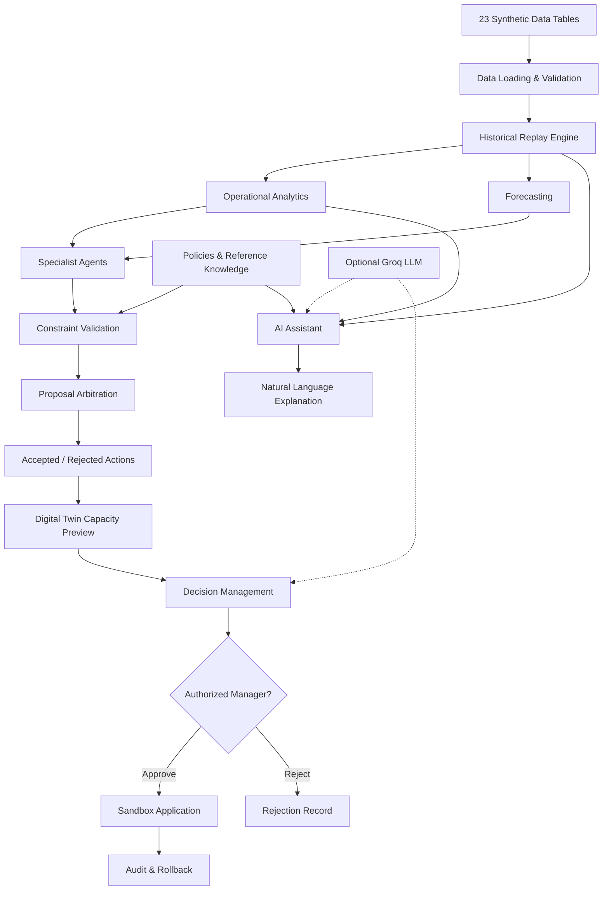
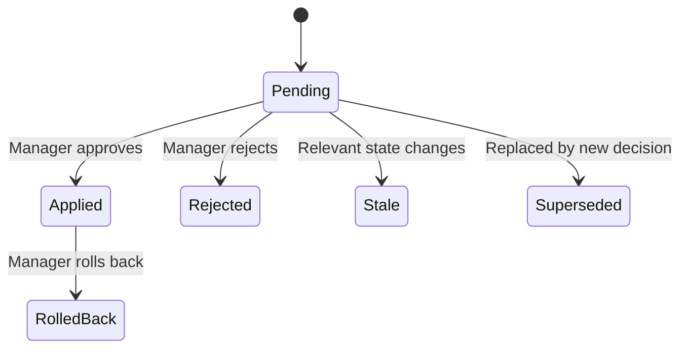
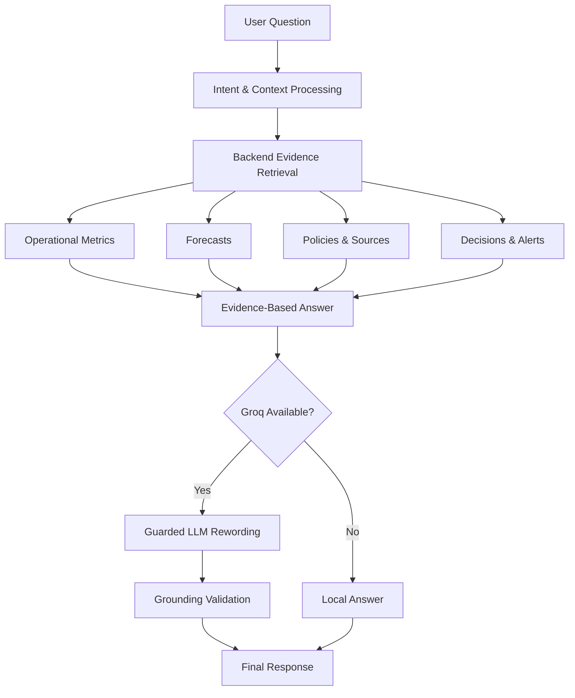

<div align="center">

# 🏥 HOSPITAL DIGITAL TWIN

### AI-Powered Hospital Operations & Decision Support Platform

**ZAWOLF · HEALTHCARE AI**

---

<kbd>🚧 ACTIVE DEVELOPMENT</kbd>
<kbd>🧪 SYNTHETIC PROTOTYPE</kbd>
<kbd>🐍 PYTHON 3.11+</kbd>

<kbd>🤖 7 SPECIALIST AGENTS</kbd>
<kbd>📊 23 DATA TABLES</kbd>
<kbd>🌍 ARABIC / ENGLISH</kbd>
<kbd>⚡ GROQ OPTIONAL</kbd>

<br>

### Observe. Analyze. Simulate. Decide.

**An intelligent hospital operations platform that brings together data analytics, specialized AI agents, forecasting, and human-supervised decisions in one interactive environment.**

Explore hospital operations, detect bottlenecks, evaluate potential actions, and understand the impact of operational decisions before applying changes to a controlled sandbox.

<br>

[**🧠 Architecture**](#-system-architecture) ·
[**✨ Features**](#-key-features) ·
[**🚀 Quick Start**](#-quick-start) ·
[**🧪 Testing**](#-testing--quality-assurance) ·
[**🗺️ Roadmap**](#-development-roadmap)

---

**Project Status: Under Active Development**

*Built and continuously improved by the Zawolf team.*

</div>

> [!IMPORTANT]
> **This project is currently a development and testing prototype.**
>
> The included dataset is synthetic. The system is not connected to a live hospital, does not provide validated clinical recommendations, and is not intended for real patient-care decisions.
>
> Features described as planned or partially implemented should not be considered production-ready.

---

# ✦ 01. Project Overview

## What Is Hospital Digital Twin?

Hospitals operate through multiple interconnected systems:

- Emergency departments
- Intensive care units
- Inpatient wards
- Operating rooms
- Medical staff and nursing teams
- Patient appointments
- Hospital resources
- Operational and financial workflows

Each system generates information that affects other hospital departments.

For example:

An unexpected increase in emergency arrivals may increase ICU demand, reduce available beds, create additional staffing requirements, and delay scheduled surgeries.

Traditional dashboards usually display these indicators separately.

**Hospital Digital Twin aims to connect these operational signals into a unified decision-support environment.**

Instead of only asking:

> "How many ICU beds are occupied?"

The system explores questions such as:

> "What happens if ICU demand increases significantly?"

> "Which operational constraints prevent additional capacity?"

> "What actions can the hospital consider?"

> "Which recommendations can be verified against available policies and resources?"

The goal is to support a workflow that moves from monitoring to analysis, proposals, validation, and controlled decision-making.

## The Core Idea

```text
Hospital Operational Data
          |
          v
+---------------------------+
|   Hospital State Model    |
|   Historical Replay       |
+---------------------------+
          |
          v
+---------------------------+
|   Analytics & Forecasts   |
|   Capacity & Bottlenecks  |
+---------------------------+
          |
          v
+---------------------------+
|   7 Specialist AI Agents  |
|   Operational Proposals   |
+---------------------------+
          |
          v
+---------------------------+
|   Constraints & Policies  |
|   Proposal Arbitration    |
+---------------------------+
          |
          v
+---------------------------+
|   Digital Twin Preview    |
|   Before / After          |
+---------------------------+
          |
          v
+---------------------------+
|   Human Decision Review   |
|   Approve / Reject        |
+---------------------------+
          |
          v
+---------------------------+
|   Controlled Sandbox      |
|   Audit & Rollback        |
+---------------------------+
```

The current implementation focuses on historical replay, operational analytics, constrained proposals, and capacity-based what-if analysis.

A comprehensive patient-flow and discrete-event simulation engine remains a future development milestone.

---

# ✦ 02. Project Objectives

The platform is being developed around six primary objectives.

| Objective | Description |
|:----------|:------------|
| 🏥 Operational Visibility | Provide a unified view of hospital departments, beds, staff, and resources |
| 📊 Data-Driven Analysis | Identify operational pressure, utilization, delays, and data-quality problems |
| 🤖 Agent-Based Recommendations | Generate specialized operational proposals based on available data |
| 🧪 Scenario Exploration | Explore hypothetical demand changes and measurable capacity impacts |
| 🛡️ Controlled Decision-Making | Validate proposals against constraints before human approval |
| 💬 Intelligent Assistance | Allow users to explore operational information through natural-language questions |

### Long-Term Vision

The broader vision is to develop an intelligent operational environment capable of integrating validated hospital information, simulation models, specialized AI agents, and decision-support workflows.

The current repository represents an evolving foundation toward that goal.

---

# ✦ 03. Key Features

## 🧭 1. Hospital Overview Dashboard

A centralized dashboard providing an overview of the hospital at a selected historical moment.

Current capabilities include:

- Total bed capacity
- Patient occupancy indicators
- Emergency and ICU metrics
- Staff availability indicators
- Operating-room utilization
- Waiting-time metrics
- Operational alerts
- Historical trends
- Department-level visualizations

The interface supports Arabic and English.

The visual design uses a modern dark dashboard with structured cards, charts, and operational status indicators.

## 🛏️ 2. Bed Capacity & ICU Monitoring

Explore operational capacity across hospital departments.

Features include:

- Available and occupied beds
- Department capacity
- ICU demand indicators
- Potential capacity shortages
- Bed allocation proposals
- Supporting staffing constraints
- Capacity utilization calculations

Critical capacity changes can be blocked when reliable staffing policies or resource information are unavailable.

## 🚑 3. Emergency Department Monitoring

Monitor emergency department conditions using the provided dataset.

Available information may include:

- Emergency arrivals
- Waiting-time indicators
- Department pressure
- Historical arrival patterns
- Operational constraints
- Data availability warnings

This module is currently focused on monitoring and analysis rather than a complete emergency-department queue simulator.

## 👩‍⚕️ 4. Staff & Nursing

Examine staffing availability and workload indicators.

The module includes:

- Staff records
- Recorded shifts
- Department assignments
- Staffing availability
- Workload indicators
- Data-quality warnings

Staffing recommendations depend on available data and relevant operational rules.

Missing records are not treated as proof that additional personnel are available.

## 🩺 5. Operating Room Management

Analyze operating-room schedules and utilization.

Capabilities include:

- Scheduled surgeries
- Operating-room utilization
- Delayed procedures
- Non-urgent surgery identification
- Rescheduling proposals
- Operational scheduling constraints

**Known limitation:** Proposed dates outside verified schedule coverage require additional validation. Missing future bookings must not automatically be interpreted as confirmed room availability.

## 📈 6. Forecasting & Analytics

The platform provides historical baseline forecasts for selected operational indicators.

Current capabilities include:

- Historical trend analysis
- Baseline demand forecasting
- Forecast error reporting
- Department-level indicators
- Capacity pressure estimates
- Backtesting

**Current forecasting is based on statistical historical baselines, not fully calibrated clinical prediction models.**

Forecast outputs should be evaluated carefully, especially for departments with limited or irregular observations.

## 🧪 7. Digital Twin Scenario Preview

Users can explore hypothetical operational demand scenarios.

The current interface supports:

- Department selection
- Demand multiplier selection
- Baseline capacity assessment
- Forecast peak demand
- Estimated capacity deficit
- Agent-generated proposals
- Accepted and rejected actions
- Before-and-after capacity comparisons
- Calculable capacity-cost differences

The current engine performs constrained capacity calculations.

It does not yet provide a fully integrated patient-flow or waiting-time simulation for every proposed action.

## ✅ 8. Decision Management

The system contains a controlled decision lifecycle.

Supported operations include:

- Save pending decisions
- Review proposals
- Inspect accepted and rejected actions
- Approve decisions
- Reject decisions
- Apply accepted actions to the local sandbox
- Roll back applied changes
- Review decision history

Sensitive actions require an authenticated user with appropriate permissions.

Decisions are applied to the local sandbox, not to a real hospital management system.

## 💬 9. AI Assistant

The project contains a conversational assistant for exploring hospital operational information.

The assistant can help users understand:

- Bed capacity
- ICU conditions
- Emergency indicators
- Staffing information
- Operating-room metrics
- Forecasts
- Operational alerts
- Decisions
- Policy references
- Data-quality information

The assistant uses available backend evidence to construct answers.

Optional Groq integration can support natural-language response generation.

The assistant is not an unrestricted autonomous hospital manager and does not independently authorize operational decisions.

## 📚 10. Sources & Policies

The system includes local knowledge retrieval and policy-management components.

Current capabilities include:

- Local reference corpus
- BM25-style lexical retrieval
- Source references
- Structured policy values
- Policy validation
- Policy version tracking
- Policy-related decision constraints

The current retrieval system is primarily lexical rather than a production-grade vector or hybrid RAG architecture.

## 🛠️ 11. Data Quality & System Monitoring

The system exposes operational and technical status information.

This includes:

- Dataset coverage
- Data-quality warnings
- Missing information
- Forecast limitations
- System configuration
- Groq configuration status
- Operational readiness indicators

The system is designed to distinguish known information from unavailable or unverified results.

---

# ✦ 04. System Architecture

The platform is organized around several interconnected components.



## Main Components

| Component | Responsibility |
|:----------|:---------------|
| Data Layer | Loads and organizes hospital information |
| Historical Replay | Reconstructs the hospital state at a selected moment |
| Analytics | Calculates operational metrics and identifies pressure |
| Forecasting | Estimates demand using historical baselines |
| Specialist Agents | Produce domain-specific proposals |
| Constraints | Check whether proposed changes satisfy available rules |
| Arbitration | Resolves conflicts and accepts or rejects proposed actions |
| Digital Twin Preview | Calculates supported before-and-after capacity effects |
| Decision Management | Controls human approval and sandbox execution |
| AI Assistant | Answers operational questions using available evidence |
| Knowledge Retrieval | Retrieves policy and reference information |
| Audit System | Records decisions, changes, and reversals |

---

# ✦ 05. Multi-Agent System

## Why Multiple Agents?

Hospital operations involve different kinds of decisions.

A single general-purpose agent may struggle to account for the different constraints governing emergency care, beds, staffing, surgery schedules, and financial resources.

The current architecture therefore uses seven specialized operational agents.

Each agent focuses on a specific domain.

## The Seven Specialist Agents

| Agent | Responsibility | Example |
|:------|:---------------|:--------|
| 🚑 ER Agent | Emergency department pressure | Assess emergency capacity constraints |
| 🛏️ Bed Agent | Bed management | Propose bed-capacity redistribution |
| 👩‍⚕️ Staff Agent | Staffing and nursing | Identify staffing-related capacity limitations |
| 🩺 OR Agent | Operating room scheduling | Propose rescheduling non-urgent surgeries |
| 📅 Appointment Agent | Outpatient appointments | Identify eligible appointment adjustments |
| 📦 Resource Agent | Hospital resources | Analyze configured resource allocations |
| 💰 Finance Agent | Financial risk | Generate supported financial warning signals |

### Important Architectural Detail

The specialist agents in the current version are primarily deterministic, domain-specific Python components.

They are not seven independent LLM conversations.

Their operational proposals are generated from the available state, forecasts, rules, and constraints.

An agent may deliberately produce no proposal when it lacks sufficient information.

This behavior is preferable to fabricating an operational recommendation.

## How an Agent Run Works

```text
1. Read Hospital State
          |
          v
2. Read Relevant Forecasts
          |
          v
3. Execute Specialist Agents
          |
          v
4. Collect Proposed Actions
          |
          v
5. Validate Policies & Resources
          |
          v
6. Check Conflicts
          |
          v
7. Accept / Reject Proposals
          |
          v
8. Generate Decision Explanation
          |
          v
9. Return Results to Dashboard
```

### Example

Suppose ICU demand increases significantly.

The Bed Agent may propose reallocating beds from another department.

The OR Agent may propose rescheduling selected non-urgent procedures.

The system then evaluates whether those changes are supported by the available policies and resources.

A proposed bed transfer may be rejected when the required nurse-to-bed policy or staffing data is unavailable.

**An agent proposal is not equivalent to an approved operational decision.**

---

# ✦ 06. AI Agents vs AI Assistant

These are related but separate components.

| | Specialist Agents | AI Assistant |
|:--|:--|:--|
| Primary Role | Operational proposals | Conversational information access |
| Main Input | Hospital data, forecasts, rules | User questions and backend evidence |
| Output | Proposed actions and constraints | Natural-language answers |
| Groq Required | No | No, optional for language generation |
| Can Approve Decisions | No | No |
| Uses Data | Yes | Yes |
| Main Interaction | Agent runs and scenario previews | Chat interface |

### Example Agent Question

"What operational actions could be considered if ICU capacity becomes insufficient?"

This is handled through the specialized operational proposal pipeline.

### Example Assistant Question

"What is the current ICU capacity and what limitations are reported?"

The assistant retrieves available information and explains it.

### Current Limitation

The conversational assistant does not yet provide unrestricted natural-language orchestration of complete what-if simulations.

Natural-language scenario execution is part of the future roadmap.

---

# ✦ 07. Digital Twin & What-If Analysis

## What Is a What-If Scenario?

A what-if scenario explores the possible effects of changing one or more operational conditions.

For example:

- What if ICU demand doubles?
- What if emergency arrivals increase?
- What if additional bed capacity is required?
- What if selected non-urgent surgeries are postponed?

The current system supports configurable demand stress scenarios and constrained capacity previews.

## Example: ICU Stress Test

The following example comes from a synthetic test scenario.

**Selected replay moment:**

`17 October 2026 — 08:00`

**Department:**

`ICU`

**Demand multiplier:**

`12×`

### Observed Results

| Metric | Result |
|:-------|-------:|
| ICU Bed Capacity | 12 beds |
| Forecast Peak Demand | Approximately 43.6 |
| Estimated Bed Deficit | 32 beds |
| Peak Capacity Utilization | Approximately 363.6% |

### Agent Results

In the tested configuration:

- Two non-urgent surgical rescheduling proposals were accepted by the proposal-validation pipeline.
- A proposed transfer of 15 beds from the inpatient ward to ICU was rejected.
- The transfer was rejected because the required nurse-ratio policies or verifiable staffing constraints were unavailable.

### Capacity Comparison

| Metric | Before | After |
|:-------|-------:|------:|
| ICU Beds | 12 | 12 |
| ICU Deficit | 32 | 32 |
| Capacity Utilization | 363.6% | 363.6% |

### Interpretation

The system successfully identified a significant capacity bottleneck in this synthetic scenario.

However, the accepted scheduling proposals did not produce a verified reduction in the calculated ICU capacity deficit.

This illustrates an important principle:

**Identifying an operational problem does not mean the proposed actions have resolved it.**

### Known Scheduling Limitation

During manual testing, the OR Agent proposed moving two procedures to a date outside the verified scheduling data horizon.

This requires further validation.

A missing booking record is not proof that a future operating-room slot is available.

The team is investigating improvements to destination-slot verification.

---

# ✦ 08. Decision Lifecycle

The system follows a human-supervised decision process.



## Decision States

| Status | Meaning |
|:-------|:--------|
| Pending | Awaiting human review |
| Applied | Accepted actions applied to the sandbox |
| Rejected | Decision rejected by an authorized manager |
| Stale | Decision no longer matches relevant state or policies |
| Superseded | Replaced by another decision |
| Rolled Back | Previously applied sandbox changes reversed |

## Security & Approval

The current implementation includes:

- Authenticated sessions
- Server-side user roles
- Password-based login
- Role-based restrictions
- Decision persistence
- Audit records
- Sandbox state management
- Rollback functionality

The application does not accept a browser-provided role string as sufficient authorization.

### User Roles

| Role | Permissions |
|:-----|:------------|
| Viewer | View permitted operational information |
| Analyst | Explore analytics, agents, and scenarios |
| Operations Manager | Review, approve, reject, roll back, and manage policies |

### Safety Principle

All operational changes in this prototype are applied within the local sandbox.

They do not modify live hospital systems.

---

# ✦ 09. AI Assistant & Groq Integration

## The AI Assistant

The assistant provides a natural-language interface to hospital information.

It is designed to help users explore operational indicators without manually navigating every dashboard section.

### Example Questions

```text
What is the current ICU occupancy?

Compare emergency department pressure over the selected period.

Which departments have capacity shortages?

What are the main operational alerts?

Explain the latest forecasting limitations.

Why was the ICU bed-transfer proposal rejected?

What information is missing for a reliable staffing decision?
```

Arabic questions are also supported.

```text
كام سرير متاح في العناية المركزة؟

إيه أكتر قسم عليه ضغط؟

ليه النظام رفض نقل الأسرة؟

إيه المشاكل الموجودة في بيانات التمريض؟

اشرحلي التوصيات اللي طلعتها الوكلاء.
```

The assistant's actual ability to answer each question depends on available backend information and supported question routing.

## How the Assistant Works



## Groq Cloud

Groq is an optional LLM provider.

Default model:

`openai/gpt-oss-120b`

Groq is used to assist with language generation and explanations.

It is not responsible for authorizing operational decisions or replacing the deterministic validation pipeline.

## Without Groq

The core application can still operate using local processing.

This includes:

- Dashboard analytics
- Specialist agents
- Capacity previews
- Decision management
- Local evidence-based assistant answers

## With Groq

The system can use the configured provider for supported natural-language generation.

The integration includes a fallback path when provider results cannot be used reliably.

Actual provider behavior, rate limits, and error handling remain part of ongoing integration testing.

---

# ✦ 10. Data Architecture

## Dataset Overview

The development dataset contains:

| Property | Value |
|:---------|:------|
| Dataset Type | Synthetic |
| Total Tables | 23 |
| Historical Coverage | 90 days |
| Start Date | 23 July 2026 |
| End Date | 20 October 2026 |
| Storage | CSV files |
| Knowledge Corpus | Local structured reference documents |

## Data Categories

### Hospital Infrastructure

- `departments`
- `rooms`
- `beds`
- `bed_stays`

### Patients & Visits

- `patients`
- `visits`
- `er_events`
- `appointments`

### Staff & Nursing

- `staff`
- `staff_shifts`
- `staff_assignments`

### Operations & Resources

- `operating_rooms`
- `surgeries`
- `resources`
- `resource_bookings`

### Financial & Operational Metrics

- `cost_rates`
- `financial_daily`
- `daily_metrics`

### Analytics & Reference Data

- `forecast_results`
- `simulation_runs`
- `simulation_events`
- `decisions`
- `policy_documents`

The repository also includes `schema.sql`, which describes the dataset structure.

## Important Data Limitations

### 1. Synthetic Data

All included hospital records are fictional.

They support software development and testing.

### 2. Staffing Records

Some dates contain incomplete or unusual staffing records.

These issues are reported by the application and should be considered when interpreting staffing information.

### 3. ICU Forecasting

Irregular or low ICU occupancy observations can produce large percentage forecasting errors.

The current baselines should not be interpreted as clinically validated predictions.

### 4. Historical Coverage

The available dataset has a limited historical range.

The system should not assume that missing future records represent verified resource availability.

### 5. Operational Policies

Reference documents and manager-entered values are not automatically equivalent to approved hospital policies.

Policy provenance and verification remain important constraints.

---

# ✦ 11. Dashboard Sections

The current dashboard contains 13 functional sections.

| # | Section | Purpose |
|:-:|:--------|:--------|
| 01 | Overview | Hospital-level KPIs, trends, and alerts |
| 02 | Alerts & Recommendations | Operational warnings and priorities |
| 03 | Beds & ICU | Bed capacity and ICU indicators |
| 04 | Emergency & Departments | Emergency pressure and department performance |
| 05 | Staff & Nursing | Staff availability, assignments, and workloads |
| 06 | Operating Rooms | Surgical scheduling and utilization |
| 07 | Forecasting | Predictions, trends, and error indicators |
| 08 | AI Agents | Specialist agent outputs and explanations |
| 09 | Digital Twin | What-if scenarios and capacity previews |
| 10 | Decisions | Approval, rejection, audit, and rollback |
| 11 | AI Assistant | Natural-language operational questions |
| 12 | Sources & Policies | Evidence and operational policy references |
| 13 | Data & System | Data quality and system configuration |

## Interface Design

The project currently uses:

- Dark dashboard design
- Arabic RTL layout
- English language option
- KPI cards
- Interactive charts
- Department-level visualizations
- Color-coded operational indicators
- Navigation sidebar
- Decision review interfaces
- Responsive layout

### Visual Information Categories

| Color | Information Type |
|:------|:-----------------|
| Cyan | Observed operational data |
| Violet | Forecast information |
| Amber | Scenario preview and simulation-related information |
| Green | Agent-generated outputs |
| Red / Amber | Warnings and operational alerts |

These visual categories help distinguish recorded information from estimates, proposals, and warnings.

---

# ✦ 12. Technology Stack

| Layer | Technology |
|:------|:-----------|
| Programming Language | Python 3.11+ |
| Backend | Python standard-library HTTP server |
| API | JSON-based endpoints |
| Frontend | HTML5 |
| Styling | CSS3 |
| Interactions | Vanilla JavaScript |
| Visualization | SVG-based charts |
| Agent Logic | Domain-specific Python agents |
| Forecasting | Statistical historical baselines |
| Knowledge Retrieval | BM25-style lexical retrieval |
| LLM Provider | Groq Cloud (optional) |
| Default LLM | openai/gpt-oss-120b |
| Data Storage | CSV |
| Application State | Local JSON / JSONL persistence |
| Testing | Python unittest |
| UI Language | Arabic / English |

### Current Design Philosophy

The project favors a lightweight local application with limited external dependencies.

The core application can run without installing additional Python packages.

---

# ✦ 13. Project Structure

```text
hospital_digital_twin/
│
├── app.py
│
├── dashboard.html
│
├── static/
│   ├── app.css
│   ├── app.js
│   ├── charts.js
│   └── i18n.js
│
├── hospital_agents/
│   │
│   ├── agents/
│   │
│   ├── orchestrator.py
│   ├── constraints.py
│   ├── arbitration.py
│   ├── twin_data.py
│   ├── insights.py
│   ├── assistant.py
│   ├── llm.py
│   ├── explain.py
│   ├── policies.py
│   ├── auth.py
│   ├── store.py
│   │
│   └── ...
│
├── data/
│
├── tests/
│
├── test_and_run.py
├── test_hospital_regressions.py
├── test_additional_findings.py
│
├── schema.sql
├── validation_report.json
│
├── .env.example
├── .gitignore
├── README.md
│
├── policies/          # Runtime-managed local policies
│
└── runtime/           # Generated locally, not committed
```

## Important Modules

| File / Folder | Purpose |
|:--------------|:--------|
| `app.py` | Main application and HTTP server |
| `dashboard.html` | Dashboard HTML structure |
| `static/app.css` | Dashboard styling |
| `static/app.js` | Frontend interactions |
| `static/charts.js` | Chart rendering |
| `static/i18n.js` | Arabic and English translations |
| `hospital_agents/agents/` | Specialist operational agents |
| `hospital_agents/orchestrator.py` | Agent coordination |
| `hospital_agents/constraints.py` | Operational constraints |
| `hospital_agents/arbitration.py` | Proposal validation and conflict handling |
| `hospital_agents/twin_data.py` | Hospital data adaptation and replay |
| `hospital_agents/assistant.py` | Conversational assistant |
| `hospital_agents/llm.py` | Optional Groq integration |
| `hospital_agents/auth.py` | Authentication |
| `hospital_agents/store.py` | Persistent application state |
| `tests/` | Automated tests |

---

# ✦ 14. Quick Start

## Prerequisites

- Python 3.11 or newer
- Git (for cloning)
- A modern web browser

The core application does not require additional package installation in the current version.

## Step 1 — Clone the Repository

```bash
git clone https://github.com/Hospital-Digital-Twin/Zawolf-Hospital-Digital-Twin.git

cd Zawolf-Hospital-Digital-Twin
```

## Step 2 — Run the Application

```bash
python app.py
```

The server starts locally.

Open:

**http://127.0.0.1:8000**

## Step 3 — First Login

On first run, the application creates local accounts for:

- `manager`
- `analyst`
- `viewer`

Initial credentials are printed to the terminal when accounts are first created.

Do not share those credentials publicly.

## Useful Commands

Run on another port:

```bash
python app.py --port 8001
```

Specify the dataset directory:

```bash
python app.py --data data
```

Reset local credentials when required:

```bash
python app.py --reset-credentials
```

Use the credential reset operation carefully because it changes local authentication state.

---

# ✦ 15. Configure Groq (Optional)

The application works without a Groq API key.

To enable the optional provider, create a `.env` file in the project root.

Example:

```env
GROQ_API_KEY=your_api_key_here
GROQ_MODEL=openai/gpt-oss-120b
```

Get an API key from:

https://console.groq.com/

Restart the application:

```bash
python app.py
```

Then open:

**Data & System → Test Connection**

The connection test is intended to make a real provider request.

A configured key does not automatically guarantee that the provider is reachable or the request will succeed.

## Optional Configuration

Depending on the current implementation, supported environment settings include:

```env
GROQ_TIMEOUT_S=30
GROQ_MAX_TOKENS=1024
GROQ_MAX_CALLS_PER_MIN=10
```

Values shown above are configuration examples, not required production settings.

## Security

> [!WARNING]
> Never commit your real `.env` file, passwords, session tokens, or generated runtime credentials to GitHub.

Make sure `.gitignore` includes:

```gitignore
.env
.env.*
!.env.example

runtime/

__pycache__/
*.pyc

.venv/
venv/

.pytest_cache/

*.log
```

If an API key has previously been uploaded or shared, rotate it through the provider dashboard.

---

# ✦ 16. Testing & Quality Assurance

The project is under active testing.

Automated tests are combined with manual functional testing.

## Automated Tests

Run the main test suite:

```bash
python -m unittest discover -s tests -v
```

Run the existing regression test runner:

```bash
python test_and_run.py
```

Run additional regression tests:

```bash
python -m unittest test_additional_findings -v
```

Some optional UI tests require additional browser or Node.js tooling.

A skipped test must not be counted as a successful test.

## What Are We Testing?

The team is evaluating:

- Functional correctness
- Operational calculations
- Agent outputs
- Constraint enforcement
- Decision persistence
- Authentication
- Sandbox rollback
- Forecasting accuracy
- Data-quality reporting
- AI assistant behavior
- Groq integration
- UI functionality
- Arabic and English support
- Responsive design

Automated success does not establish production or clinical readiness.

---

# ✦ 17. Team Testing Responsibilities

The project is being tested collaboratively.

To avoid duplicated effort, manual testing can be divided among five team members.

| Tester | Area | Responsibilities |
|:------:|:-----|:-----------------|
| 1 | Overview & Alerts | Dashboard metrics, navigation, historical replay, operational warnings |
| 2 | AI Agents & Assistant | Seven agents, assistant responses, RAG sources, Groq behavior |
| 3 | Digital Twin & Decisions | Scenario previews, proposed actions, approval, rejection, rollback |
| 4 | Hospital Operations | Beds, ICU, emergency, staff, operating rooms, scheduling |
| 5 | Forecasts & Quality | Forecasting, data validation, authentication, UI and language checks |

## Testing Guidelines

Each tester should:

1. Use an independent local project copy.
2. Run the application successfully.
3. Test the assigned features.
4. Compare actual results with expected behavior.
5. Record unexpected outputs.
6. Capture screenshots when relevant.
7. Avoid changing production or shared credentials.
8. Report reproducible bugs to the team.

Separate test environments are important because the system stores mutable decisions, policies, and sandbox state.

## Bug Report Template

```text
Bug Title:

Module / Feature:

Test Date:

User Role:

Replay Date & Time:

Scenario Parameters:

Steps to Reproduce:

Expected Result:

Actual Result:

Severity:
Critical / High / Medium / Low

Evidence:
Screenshot / Error Log

Current Status:
Open / Reproduced / Fixed / Retested
```

## Example Issue

**Title:** Operating-room rescheduling beyond available schedule coverage

**Scenario:** ICU demand multiplier ×12

**Observed:** Two non-urgent procedures were proposed for a future date without verified destination-calendar coverage.

**Expected:** The system should verify the destination slot and relevant scheduling constraints or clearly mark the proposal as unverified.

**Status:** Requires further investigation and validation.

---

# ✦ 18. Current Limitations

The team is actively working on several limitations.

## Simulation

The current implementation does not contain a fully integrated discrete-event hospital simulation engine.

It cannot yet reliably calculate the per-action impact on:

- Patient queue waiting times
- Complete patient journeys
- Clinical outcomes
- Realized financial performance
- Overtime requirements

## Forecasting

Forecasting currently relies on historical baseline techniques.

Further work is required on:

- Forecast evaluation
- Model comparison
- ICU prediction accuracy
- Data uncertainty
- Forecast calibration

## Staffing

Reliable staffing projections require trustworthy demand information, validated policies, and resource data.

Some inputs are missing or incomplete.

## Operating Room Scheduling

Future-slot verification requires improvement.

The system must not assume resource availability beyond known schedule coverage.

## AI Assistant

The assistant currently supports evidence-based operational questions.

Future improvements include:

- Broader natural-language understanding
- Improved multi-turn context handling
- Stronger source-based explanations
- Natural-language scenario execution
- Better integration with validated agent workflows

## Digital Twin Visualization

The current department visualization is an operational schematic.

It is not a verified spatial 3D model of a physical hospital.

---

# ✦ 19. Development Roadmap

This roadmap reflects the current development direction and may change as the team completes testing.

| Status | Feature |
|:------:|:--------|
| ✅ | Local hospital operations dashboard |
| ✅ | Arabic / English interface |
| ✅ | Historical hospital replay |
| ✅ | Seven specialist operational agents |
| ✅ | Proposal arbitration and constraint validation |
| ✅ | Capacity-based what-if preview |
| ✅ | Human-supervised decision workflow |
| ✅ | Sandbox persistence and rollback |
| ✅ | Local evidence-based assistant |
| ✅ | Optional Groq integration in code |
| 🟡 | Improved operating-room scheduling validation |
| 🟡 | More accurate forecasting |
| 🟡 | Staffing and resource analysis |
| 🟡 | Expanded assistant capabilities |
| 🟡 | Additional functional and security testing |
| ⬜ | Complete discrete-event simulation engine |
| ⬜ | Patient-flow and queue simulation |
| ⬜ | Natural-language what-if orchestration |
| ⬜ | Advanced semantic / hybrid knowledge retrieval |
| ⬜ | Verified hospital-system integrations |
| ⬜ | Real spatial hospital digital twin |
| ⬜ | Production deployment and operational validation |

**Legend**

- ✅ Implemented baseline
- 🟡 Partially implemented or undergoing improvement
- ⬜ Planned

---

# ✦ 20. Troubleshooting

| Problem | Possible Cause | Suggested Action |
|:--------|:---------------|:-----------------|
| Application does not start | Incorrect Python version or missing files | Check Python 3.11+ and project structure |
| `ModuleNotFoundError` | Missing project module | Verify the complete project files were copied |
| Port 8000 unavailable | Another application uses the port | Run with `--port 8001` |
| Missing login credentials | Existing runtime state | Review local runtime configuration or reset credentials |
| Groq not configured | Missing API key | Add the key to `.env` |
| Groq timeout or rate limit | Provider availability or quota | Check provider status and fallback behavior |
| Bed transfer rejected | Missing policy or staffing information | Review the relevant constraints |
| No change in capacity | Accepted actions do not modify measurable capacity | Review the scenario output |
| Simulation unavailable | Required simulation engine not implemented | Treat the metric as unavailable |
| Tests skipped | Missing optional test tooling | Install required tooling or report skipped tests |
| Unexpected decision changes | Sandbox or policy state changed | Inspect audit history and test environment |

---

# ✦ 21. Engineering Principles

## 🔎 Evidence Before Conclusions

Operational claims should be supported by available data or clearly marked as estimates.

## 🛡️ Safety Before Automation

Critical changes must satisfy relevant constraints.

When required evidence is unavailable, the system should avoid making unsupported changes.

## 🧑‍💼 Human-in-the-Loop

Operational proposals require explicit human review.

The LLM does not have independent decision authority.

## 🔄 Reversible Experimentation

Approved changes are applied inside a controlled sandbox.

Rollback and audit records support testing and investigation.

## 🧠 Separate Language Generation From Decision Logic

The LLM supports explanation and interaction.

Operational calculations and validation remain controlled by backend logic.

## 📊 Transparent Data Limitations

Missing data, low-confidence outputs, and unsupported simulation results should be identified clearly.

## 🧪 Test Before Trust

Automated tests, manual scenarios, regression tests, and data validation are necessary before extending the system.

## 🏥 No Unsupported Clinical Claims

The project is an operational prototype using synthetic information.

It should not be presented as a validated clinical decision system.

---

# ✦ 22. Contributing

This project is being developed collaboratively by the Zawolf team.

Contributions should focus on:

- Reliability
- Maintainability
- Clear architecture
- Testable functionality
- Operational correctness
- Safe AI integration
- UI/UX improvements
- Documentation

## Recommended Workflow

```bash
# Clone the repository
git clone https://github.com/Hospital-Digital-Twin/Zawolf-Hospital-Digital-Twin.git

# Open the project
cd Zawolf-Hospital-Digital-Twin

# Create a feature branch
git checkout -b feature/your-feature-name

# Make your changes and test them

# Stage modifications
git add .

# Commit
git commit -m "Describe your changes"

# Push your branch
git push -u origin feature/your-feature-name
```

Open a Pull Request to submit changes for review.

Avoid committing credentials, generated sessions, or personal test data.

---

# ✦ 23. Project Status

> [!NOTE]
> This README is a development reference for the current repository snapshot.
>
> The project is still being tested, revised, and expanded by the team.
>
> Architecture, features, user interfaces, and implementation details may evolve as development progresses.

### Current Focus

1. Complete functional testing across all major modules.
2. Verify agent outputs and scheduling constraints.
3. Improve decision reliability.
4. Evaluate assistant behavior and Groq integration.
5. Improve forecasts and data-quality handling.
6. Continue refining the user experience.
7. Design the next generation of the hospital simulation engine.

---

<div align="center">

# 🏥 ZAWOLF

### Hospital Digital Twin & Operations Platform

**An evolving project combining operational intelligence, specialized AI agents, forecasting, and human-supervised decision support.**

---

**OBSERVE → ANALYZE → PROPOSE → VALIDATE → REVIEW → IMPROVE**

<br>

**Developed collaboratively by the Zawolf Team**

[**GitHub Repository**](https://github.com/Hospital-Digital-Twin/Zawolf-Hospital-Digital-Twin)

<br>

*Built for experimentation, transparency, and continuous improvement.*

**Active Development · Synthetic Data · Research & Testing Prototype**

</div>